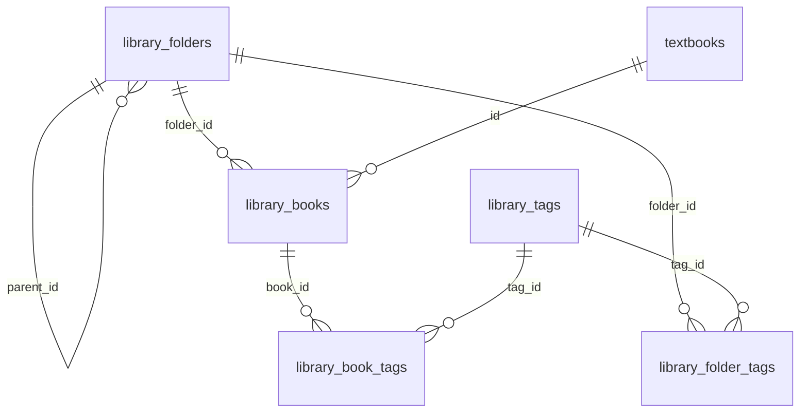

# Relacijska knjižnica

V Supabase SQL Editorju zaženi **celotno** [20261116_library.sql](../supabase/20261116_library.sql), nato osveži aplikacijo. Skripta predpostavlja obstoječo tabelo `user_answers` iz prve migracije. Skrbniški ključ v aplikaciji ni potreben.

| Tabela | Namen in ključni stolpci |
| --- | --- |
| `textbooks` | Katalog: `id`, `name`, `language_code`, `kind`, `sort_order` |
| `library_folders` | Mape: `user_id`, `id`, `parent_id`, `name`, `sort_order` |
| `library_tags` | Oznake: `user_id`, `id`, `name`, `color` |
| `library_books` | Gradiva uporabnika: `user_id`, `id` → katalog, `folder_id`, `name`, `sort_order` |
| `library_folder_tags` | Povezave map z oznakami: `user_id`, `folder_id`, `tag_id` |
| `library_book_tags` | Povezave gradiv z oznakami: `user_id`, `book_id`, `tag_id` |
| `library_settings` | `user_id`, `initialized_at`; prepreči ponovno ustvarjanje izbrisanih gradiv |
| `user_answers` | Samo učni odgovori; obstoječi identifikatorji polj ostanejo isti |

Mapa ali gradivo ima lahko več oznak, oznaka pa pripada več elementom. Zato so povezave v povezovalnih tabelah s tujimi ključi, ne v besedilnem stolpcu z naštevanjem ID-jev. Enaka povezava se ne more podvojiti. `sort_order` je podatek za razvrščanje, ne identifikator drugega objekta.



Vse uporabniške povezave vključujejo `user_id`, vezan na Supabase Auth. Sestavljeni tuji ključi in RLS preprečijo povezave ali spremembe v drugem računu. Imena oznak so enolična znotraj računa ne glede na velikost črk. Preverijo se dolžine imen, barve, nenegativen vrstni red in cikli map. Indeksi pokrivajo nadrejeno mapo, vrstni red in iskanje povezav po oznaki. Elementi imajo čas nastanka in zadnje spremembe.

`library_read()` vrne dosleden posnetek knjižnice. `library_apply_changes()` v eni transakciji zapiše spremembo elementa in njegovih oznak. Vrstni red sočasnih zapisov istega računa varuje transakcijsko zaklepanje. Javna inicializacija ne sprejema ID-ja uporabnika; uporabi preverjeno sejo.

SQL najprej prenese stare knjižnične zapise z `book_id = '__library__'`, vključno z mapami, oznakami in izbrisanimi gradivi. Nato preveri integriteto in odstrani samo te zapise. Učni odgovori ostanejo. Če se pojavi neveljaven podatek, se transakcija v celoti razveljavi. Skripto lahko ponovno zaženeš brez ponovnega ustvarjanja izbrisane knjižnice. Omejitev na `user_answers` prepreči, da bi stari odjemalec tja znova pisal mape.

Stare lokalne podatke aplikacija prenese pri prvi inicializaciji računa. Že inicializirane knjižnice ne prepiše z zastarelim lokalnim posnetkom. Morebitna neposlana dejanja iz prejšnje različice preidejo v novo lokalno čakalno vrsto. Knjižnica in učni odgovori imata ločena ponudnika stanja in ločena lokalna varnostna zapisa. Izvirno učno besedilo, slike in slovar ostanejo datoteke projekta; katalog hrani njihove identifikatorje in opisne podatke.

Izbris mape odstrani podmape, uporabnikova gradiva v njih in njihove povezave z oznakami. Katalog in učni odgovori se ohranijo. Izbris oznake odstrani njene povezave, ne map ali učnih odgovorov.

Preverjanje:

```powershell
node --experimental-transform-types --test scripts/library-database.test.mjs
node --experimental-transform-types --test scripts/library-store.test.mjs scripts/answer-store.test.mjs
npm.cmd run build
```

Podatkovni testi poganjajo PostgreSQL prek PGlite z ločenima testnima računoma in vlogama `authenticated` ter `anon`. Ne pišejo v dejanski Supabase projekt.
